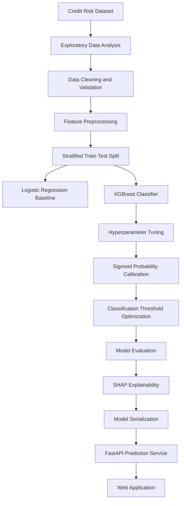
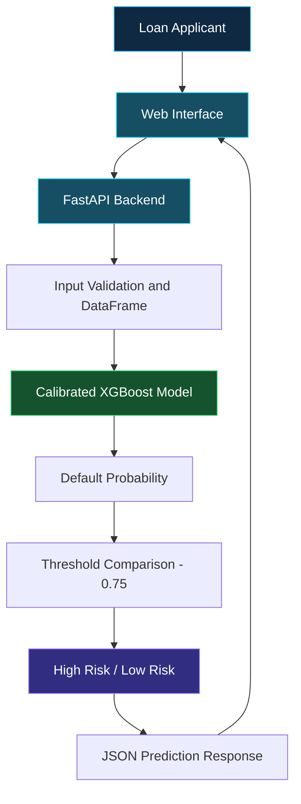

 <div align="center">


<br/>


<br/><br/>

<a href="https://github.com/Aradhy2005/Credit-Risk-Assessment">

</a>


<br/>


<br/><br/>

**An end-to-end Machine Learning application for predicting loan default risk through calibrated classification and explainable AI.**

<br/>

[Overview](#-overview) · [Performance](#-model-performance) · [ML Pipeline](#-machine-learning-pipeline) · [Architecture](#-system-architecture) · [Installation](#-getting-started)

</div>

---

# 01. ◈ Overview

Credit risk assessment is an important part of lending decisions. However, predicting whether a borrower may default is only one part of the problem. Understanding the factors behind a prediction is equally important.

**Explainable Credit Risk Assessment** is a Machine Learning project that estimates the probability of loan default using a calibrated XGBoost classification model.

The project brings together:

- Exploratory Data Analysis and data preprocessing.
- Logistic Regression baseline modelling.
- XGBoost model training and hyperparameter optimization.
- Probability calibration using sigmoid calibration.
- Classification threshold optimization.
- SHAP-based global and local explainability.
- FastAPI-based model serving.
- Interactive web application for risk assessment.

The objective is to combine predictive performance with interpretable model behaviour.

## ✦ Project Highlights

<table>
<tr>
<td width="50%">
<h3>01 · Predictive Intelligence</h3>
XGBoost classification with hyperparameter optimization and calibrated probabilities.
</td>
<td width="50%">
<h3>02 · Explainable AI</h3>
SHAP-based analysis to investigate global feature importance and individual predictions.
</td>
</tr>
<tr>
<td width="50%">
<h3>03 · Decision Optimization</h3>
Precision-recall analysis and F1-based classification threshold selection.
</td>
<td width="50%">
<h3>04 · Application Integration</h3>
FastAPI backend connected to an interactive HTML, CSS and JavaScript interface.
</td>
</tr>
</table>

---

# 02. ◈ Model Performance

<div align="center">

## FINAL MODEL — CALIBRATED XGBOOST

<table>
<tr>
<td align="center" width="25%">
<h1><font color="#0EA5E9">94%</font></h1>
<strong>ACCURACY</strong>
</td>
<td align="center" width="25%">
<h1><font color="#16A34A">98%</font></h1>
<strong>PRECISION</strong>
</td>
<td align="center" width="25%">
<h1><font color="#D97706">74%</font></h1>
<strong>RECALL</strong>
</td>
<td align="center" width="25%">
<h1><font color="#8B5CF6">0.84</font></h1>
<strong>F1-SCORE</strong>
</td>
</tr>
</table>


</div>

## Model Comparison

The following results are taken from the final model evaluation cells in the notebook.

| Evaluation Metric | Logistic Regression | XGBoost | Calibrated XGBoost |
|:---|---:|---:|---:|
| Accuracy | 82% | 93% | **94%** |
| Precision | 56% | 84% | **98%** |
| Recall | 79% | 81% | 74% |
| F1-score | 0.65 | 0.82 | **0.84** |

## Performance Improvement

| Metric | Baseline | Final | Improvement |
|:---|---:|---:|---:|
| Accuracy | 82% | 94% | +12 percentage points |
| Precision | 56% | 98% | +42 percentage points |
| F1-score | 0.65 | 0.84 | +29.2% relative |

### Understanding the final model

- **94% Accuracy:** Overall proportion of correct predictions.
- **98% Precision:** Of the applicants predicted as default cases, 98% were actual default cases in this test evaluation.
- **74% Recall:** The model identified 74% of actual default cases.
- **0.84 F1-score:** Harmonic mean of precision and recall.

The final classification threshold was selected as **0.75** using precision-recall analysis and F1-score optimization.

<details>
<summary><strong>View detailed final classification report</strong></summary>

| Class | Precision | Recall | F1-score | Support |
|:---|---:|---:|---:|---:|
| Non-default (0) | 0.93 | 1.00 | 0.96 | 4,943 |
| Default (1) | 0.98 | 0.74 | 0.84 | 1,362 |
| **Overall accuracy** | | | **0.94** | **6,305** |
| Macro average | 0.96 | 0.87 | 0.90 | 6,305 |
| Weighted average | 0.94 | 0.94 | 0.94 | 6,305 |

</details>

<blockquote>
<strong>Evaluation transparency:</strong> The current notebook selects the classification threshold using test-set probabilities and evaluates on that same test split. This introduces potential test-set leakage and can make the reported performance optimistic. The results are experimental notebook results, not an independently validated production benchmark. A separate validation-based threshold selection and untouched final test evaluation are important next steps.
</blockquote>

---

# 03. ◈ Dataset Overview

The project uses a loan credit-risk dataset containing demographic, financial and credit-history attributes.

<div align="center">

| DATASET STATISTIC | VALUE |
|:---:|:---:|
| Initial records | **32,581** |
| Records after duplicate removal | **32,416** |
| Test samples | **6,305** |
| Input features | **11** |
| Target variable | `loan_status` |

</div>

## Input Features

| Feature | Description |
|:---|:---|
| `person_age` | Applicant age |
| `person_income` | Annual income |
| `person_home_ownership` | Home ownership status |
| `person_emp_length` | Employment length |
| `loan_intent` | Loan purpose |
| `loan_grade` | Loan grade |
| `loan_amnt` | Loan amount |
| `loan_int_rate` | Interest rate |
| `loan_percent_income` | Loan amount as a proportion of income |
| `cb_person_default_on_file` | Historical default indicator |
| `cb_person_cred_hist_length` | Credit history length |

**Target variable — `loan_status`**

- `0` — Non-default
- `1` — Default

---

# 04. ◈ Machine Learning Pipeline

The model development process follows a structured workflow, from raw data exploration to model serving.



## Model Development Stages

### 01 — Data Exploration and Preprocessing

- Exploratory Data Analysis.
- Missing-value inspection and handling.
- Duplicate removal.
- Outlier handling and validation.
- Numerical and categorical feature preprocessing.
- Stratified train-test splitting.

### 02 — Baseline Model

Logistic Regression was implemented as the baseline classifier to establish a reference point for evaluating more complex models.

### 03 — XGBoost Classification

XGBoost was trained to capture nonlinear relationships and feature interactions in credit-risk data.

### 04 — Hyperparameter Optimization

`RandomizedSearchCV` was used to explore model hyperparameters.

Notebook execution:

- 150 parameter candidates.
- 5-fold cross-validation.
- 750 total fitting operations.
- Reported tuning score: approximately 0.90.

### 05 — Probability Calibration

Sigmoid calibration was implemented using `CalibratedClassifierCV`.

The purpose is to improve the relationship between predicted probabilities and observed outcome frequencies.

### 06 — Threshold Optimization

A classification threshold of 0.75 was selected using precision-recall analysis and F1-score optimization.

This changes the decision boundary from the conventional 0.50 threshold.

### 07 — Final Evaluation

The final model was evaluated using accuracy, precision, recall, F1-score and a classification report.

---

# 05. ◈ Explainable AI — SHAP

<div align="center">


**Understanding why a model makes a prediction.**

</div>

A credit-risk prediction should be more than a probability or classification label.

This project incorporates **SHAP (SHapley Additive exPlanations)** to examine the contribution of input features to model predictions.

### Global Explainability

Investigates feature influence across the evaluated dataset and helps identify which attributes contribute most to model behaviour.

### Local Explainability

Examines individual predictions and shows how input features contribute to a particular model output.

### SHAP Analysis Included

- SHAP summary plot.
- Global feature contribution analysis.
- Individual prediction waterfall plot.

The notebook uses the tuned XGBoost estimator for SHAP interpretation. The deployed model is the calibrated classifier.

---

# 06. ◈ System Architecture

The application separates the user interface, prediction API and trained machine learning model.



## Technology Responsibilities

| Layer | Responsibility | Technology |
|:---|:---|:---|
| Frontend | Loan application form and result display | HTML, CSS, JavaScript |
| Backend | API and request processing | FastAPI |
| ML engine | Default probability prediction | XGBoost, Scikit-learn |
| Explainability | Model interpretation | SHAP |
| Serialization | Saving model artifacts | Joblib |
| Deployment configuration | Web service setup | Render |

---

# 07. ◈ API Reference

### Prediction Endpoint

`POST /predict`

The API accepts applicant information and returns a risk assessment.

| Response Field | Description |
|:---|:---|
| `default_probability` | Estimated probability of default |
| `default_prediction` | Predicted class (0 or 1) |
| `threshold` | Selected classification threshold |
| `Result` | High Risk or Low Risk |

### API Documentation

Once the application is running, access the interactive FastAPI documentation at:

`http://127.0.0.1:8000/docs`

---

# 08. ◈ Technology Stack

<div align="center">

**LANGUAGES & DEVELOPMENT**


<br/><br/>

**MACHINE LEARNING & DATA SCIENCE**


<br/><br/>

**BACKEND & DEPLOYMENT**


</div>

---

# 09. ◈ Project Structure

```text
Credit-Risk-Assessment/
│
├── static/
│   ├── index.html
│   ├── style.css
│   └── script.js
│
├── Credit_Risk.ipynb
│
├── main.py
├── requirements.txt
├── render.yaml
├── runtime.txt
│
├── credit_risk_model.pkl
├── best_threshold.pkl
│
├── credit_risk_dataset (2).csv
├── README.md
└── .gitignore
```

---

# 10. ◈ Getting Started

## Prerequisites

- Python 3.11 or a compatible version.
- Git.
- pip.

### Step 1 — Clone the repository

```bash
git clone https://github.com/Aradhy2005/Credit-Risk-Assessment.git
cd Credit-Risk-Assessment
```

### Step 2 — Create a virtual environment

```bash
python -m venv .venv
```

Activate on Windows:

```powershell
.\.venv\Scripts\Activate.ps1
```

### Step 3 — Install dependencies

```bash
pip install -r requirements.txt
```

### Step 4 — Run the application

```bash
uvicorn main:app --reload
```

### Step 5 — Open the application

| Service | Address |
|:---|:---|
| Web Application | `http://127.0.0.1:8000` |
| FastAPI Documentation | `http://127.0.0.1:8000/docs` |

---

# 11. ◈ Deployment

The repository includes a `render.yaml` configuration for deployment on Render.

Deployment workflow:

1. Connect the GitHub repository to Render.
2. Create a Web Service.
3. Configure the Python runtime.
4. Install dependencies from `requirements.txt`.
5. Start the application using Uvicorn.
6. Verify the application and prediction endpoint.

---

# 12. ◈ Future Improvements

- [ ] Separate validation-based threshold selection.
- [ ] Independent final model evaluation.
- [ ] Further false-negative analysis.
- [ ] Model fairness and bias assessment.
- [ ] Improved model monitoring.
- [ ] More detailed prediction-level explanations.
- [ ] Deployment monitoring and scalability improvements.

---

# 13. ◈ Important Evaluation Notes

The notebook reports 206 false positives and 264 false negatives in its false-positive/false-negative analysis.

The selected threshold favours high precision, but recall is lower. This trade-off matters in credit-risk applications because false negatives represent actual default cases predicted as non-default.

The project is an educational and experimental implementation. The model should not be used as the sole basis for real-world lending decisions without independent validation, fairness assessment and appropriate regulatory and domain review.

---

<div align="center">


### BUILT WITH MACHINE LEARNING. DESIGNED FOR EXPLAINABILITY.

**Aradhy Bajpai**

<a href="https://github.com/Aradhy2005">

</a>

<br/><br/>

<sub>Credit Risk Assessment · Calibrated XGBoost · Explainable AI</sub>


</div>
