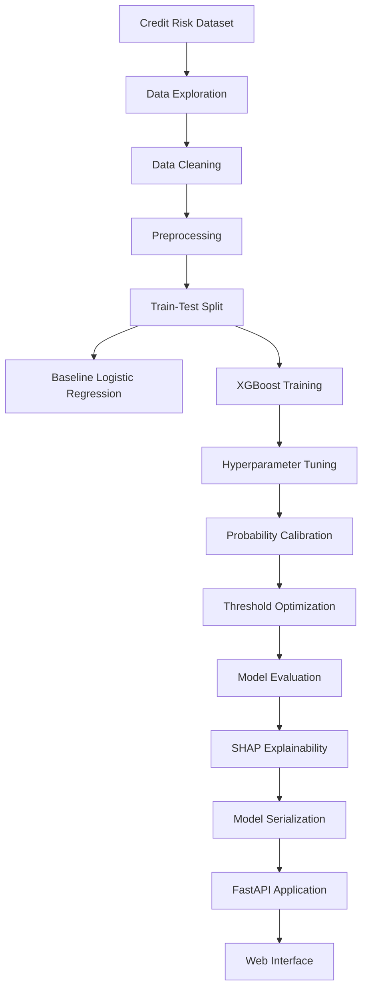

# 💳 Explainable Credit Risk Assessment

<p align="center">
  <strong>An Interpretable Machine Learning System for Credit Default Risk Prediction</strong>
  <br/>
  Predicting credit risk with Calibrated XGBoost, SHAP Explainability and FastAPI.
</p>

<p align="center">
  
  
  
  
  
  
</p>

---

## 📌 Overview

**Explainable Credit Risk Assessment** is a machine learning-based application designed to estimate the probability of loan default using applicant financial and credit-related information.

The system uses a **Calibrated XGBoost classifier** to generate credit risk predictions and integrates **SHAP (SHapley Additive exPlanations)** to interpret the factors influencing model decisions.

Unlike a conventional prediction system that only returns a classification, this project focuses on combining predictive performance with model interpretability.

The trained model is served through a FastAPI backend and connected to a web-based interface where users can submit loan application details and receive a risk assessment.

### ✨ Key Highlights

- 📊 Machine learning-based credit default prediction.
- 🚀 Calibrated XGBoost classification model.
- 🎯 Classification threshold optimization.
- 🔍 SHAP-based global and individual prediction explanations.
- ⚡ FastAPI-powered prediction service.
- 🖥️ Interactive web interface.
- ☁️ Deployment-ready application architecture.

---

## 📈 Model Performance

The project evaluates Logistic Regression, XGBoost and calibrated XGBoost to compare predictive performance and the effect of probability calibration and threshold selection.

### Final Model — Calibrated XGBoost

<table align="center">
  <tr>
    <td align="center" width="25%">
      <h1>94%</h1>
      <strong>Accuracy</strong>
    </td>
    <td align="center" width="25%">
      <h1>98%</h1>
      <strong>Precision</strong>
    </td>
    <td align="center" width="25%">
      <h1>74%</h1>
      <strong>Recall</strong>
    </td>
    <td align="center" width="25%">
      <h1>0.84</h1>
      <strong>F1-Score</strong>
    </td>
  </tr>
</table>

### Model Comparison

| Evaluation Metric | Logistic Regression | XGBoost | Calibrated XGBoost |
|:---|:---:|:---:|:---:|
| Accuracy | 82% | 93% | **94%** |
| Precision | 56% | 84% | **98%** |
| Recall | 79% | 81% | 74% |
| F1-Score | 0.65 | 0.82 | **0.84** |

### Performance Improvements

- **Accuracy:** Increased from 82% to 94%.
- **Precision:** Increased from 56% to 98%.
- **F1-Score:** Increased from 0.65 to 0.84, approximately a 29.2% relative improvement.

The final calibrated model uses a classification threshold of **0.75**, selected through a precision-recall curve and F1-score optimization.

> **Evaluation note:** The notebook currently selects the classification threshold using test-set probabilities and evaluates the model on the same test set. Consequently, these metrics are experimental results from the current notebook and may be optimistic. Independent evaluation with a separate validation-based threshold is a planned improvement.

---

## 🧠 Machine Learning Workflow

The project follows an end-to-end machine learning workflow:



### 1. Data Preparation

- Dataset exploration and statistical analysis.
- Missing-value identification and handling.
- Duplicate removal.
- Outlier inspection.
- Numerical and categorical feature preprocessing.
- Train-test splitting.

### 2. Model Development

- Logistic Regression as the baseline model.
- XGBoost for nonlinear classification.
- Hyperparameter optimization using `RandomizedSearchCV`.
- Probability calibration using sigmoid calibration (`CalibratedClassifierCV`).

### 3. Threshold Optimization

Instead of relying only on the default 0.5 classification threshold, the project uses a precision-recall curve to identify a threshold that maximizes the F1-score.

The selected threshold is stored separately and used by the deployed prediction service.

### 4. Model Explainability

SHAP is used to understand how input features influence model predictions.

---

## 🔍 Explainable AI with SHAP

Interpretability is an important part of this project.

The implementation uses SHAP with the tuned XGBoost estimator to examine the contribution of individual features to model predictions.

### Global Explainability

Identifies which features have the greatest influence across the evaluated dataset.

### Local Explainability

Explains an individual applicant's prediction by showing how different features contribute to the model output.

The notebook includes:

- SHAP summary plot.
- SHAP feature contribution analysis.
- Individual prediction waterfall plot.

This helps make model behaviour easier to investigate rather than treating the prediction as a black-box result.

---

## 📂 Dataset Information

The project uses a loan credit-risk dataset containing applicant demographic, financial and credit-history information.

| Dataset Detail | Value |
|:---|---:|
| Initial records | 32,581 |
| Records after duplicate removal | 32,416 |
| Test samples | 6,305 |
| Input features | 11 |
| Target variable | `loan_status` |

### Input Features

| Feature | Description |
|:---|:---|
| `person_age` | Applicant's age |
| `person_income` | Annual income |
| `person_home_ownership` | Home ownership status |
| `person_emp_length` | Employment length |
| `loan_intent` | Purpose of the loan |
| `loan_grade` | Loan grade |
| `loan_amnt` | Loan amount |
| `loan_int_rate` | Loan interest rate |
| `loan_percent_income` | Loan amount as a proportion of income |
| `cb_person_default_on_file` | Historical default indicator |
| `cb_person_cred_hist_length` | Credit history length |

**Target:** `loan_status`

- `0` — Non-default
- `1` — Default

---

## 🏗️ Application Architecture

The application is organized into three main layers:

| Layer | Responsibility | Technology |
|:---|:---|:---|
| Frontend | Loan application form and risk results | HTML, CSS, JavaScript |
| Backend | Input handling and prediction API | FastAPI, Python |
| ML Layer | Risk prediction and classification | Scikit-learn, XGBoost, Joblib |

### Prediction Flow

1. User enters loan applicant information.
2. Frontend sends the input to the `/predict` endpoint.
3. FastAPI converts the input into a structured DataFrame.
4. The trained calibrated model generates a default probability.
5. The stored classification threshold determines the predicted class.
6. The API returns the probability, prediction and risk category.
7. The frontend displays the result.

---

## 🛠️ Technology Stack

<p align="center">
  
</p>

| Category | Tools and Libraries |
|:---|:---|
| Language | Python |
| Data Processing | Pandas, NumPy |
| Machine Learning | Scikit-learn, XGBoost |
| Model Explainability | SHAP |
| Model Serialization | Joblib |
| Backend | FastAPI, Uvicorn |
| Frontend | HTML, CSS, JavaScript |
| Version Control | Git, GitHub |
| Deployment | Render |

---

## 📁 Project Structure

```text
Credit-Risk-Assessment/
│
├── static/
│   ├── index.html
│   ├── style.css
│   └── script.js
│
├── Credit_Risk.ipynb
│
├── main.py
├── requirements.txt
├── render.yaml
├── runtime.txt
│
├── credit_risk_model.pkl
├── best_threshold.pkl
│
├── credit_risk_dataset (2).csv
├── README.md
└── .gitignore
```

---

## ⚙️ Getting Started

Follow these steps to run the application locally.

### Prerequisites

- Python 3.11 or compatible version.
- Git.
- pip.

### 1. Clone the Repository

```bash
git clone https://github.com/Aradhy2005/Credit-Risk-Assessment.git
```

```bash
cd Credit-Risk-Assessment
```

### 2. Create a Virtual Environment

```bash
python -m venv .venv
```

Activate on Windows:

```powershell
.\.venv\Scripts\Activate.ps1
```

### 3. Install Dependencies

```bash
pip install -r requirements.txt
```

### 4. Run the Application

```bash
uvicorn main:app --reload
```

### 5. Access the Application

| Service | URL |
|:---|:---|
| Web Application | http://127.0.0.1:8000 |
| API Documentation | http://127.0.0.1:8000/docs |

---

## 🔗 API Reference

### Predict Credit Risk

`POST /predict`

The endpoint accepts applicant information and returns a credit-risk prediction.

**Response fields:**

| Field | Description |
|:---|:---|
| `default_probability` | Estimated default probability |
| `default_prediction` | Predicted class (0 or 1) |
| `threshold` | Classification threshold |
| `Result` | High Risk or Low Risk |

---

## 🚀 Deployment

The application includes a `render.yaml` configuration for deployment on Render.

Deployment workflow:

1. Connect the GitHub repository to Render.
2. Create a new Web Service.
3. Configure the Python environment.
4. Install dependencies using `requirements.txt`.
5. Start the service using Uvicorn.
6. Access the deployed application through its public URL.

---

## 🔮 Future Improvements

- Independent model evaluation with validation-based threshold selection.
- Further optimization of false-negative predictions.
- Model fairness and bias analysis.
- Additional model monitoring and evaluation.
- More detailed prediction-level explanations.
- Improved deployment monitoring and scalability.

---

## ⚠️ Disclaimer

This project is developed for educational and experimental purposes. Its predictions should not be used as the sole basis for real-world lending, credit approval or financial decisions.

Credit risk models require independent validation, fairness assessment, regulatory review and domain-specific oversight before production use.

---

## 👨‍💻 Author

**Aradhy Bajpai**

[GitHub](https://github.com/Aradhy2005)

---

<p align="center">
  <strong>Making Credit Risk Prediction More Explainable.</strong>
  <br/>
  <sub>Machine Learning · Explainable AI · Fast